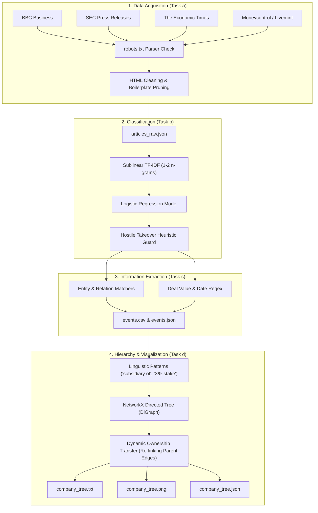

# 📈 Corporate Event Miner
### Web Text Classification & Information Extraction on Financial News

[](https://www.python.org/)
[](https://scikit-learn.org/)
[](https://networkx.org/)
[](https://www.crummy.com/software/BeautifulSoup/)
[](LICENSE)

An end-to-end Natural Language Processing (NLP) and Web Mining pipeline designed to automatically discover, crawl, classify, extract, and structure corporate financial events from live financial media and regulatory announcements.

---

## 📑 Table of Contents
- [Project Overview](#-project-overview)
- [Key Features & Assignment Tasks](#-key-features--assignment-tasks)
- [System Architecture](#-system-architecture)
- [Project Structure](#-project-structure)
- [Installation & Quickstart](#-installation--quickstart)
- [Command-Line Options](#-command-line-options)
- [Sample Outputs & Results](#-sample-outputs--results)
- [Methodology & Evaluation](#-methodology--evaluation)
- [Documentation & Full Report](#-documentation--full-report)

---

## 🚀 Project Overview

Financial news is voluminous, fast-moving, and predominantly unstructured. Market analysts, quantitative traders, and regulatory auditors require real-time visibility into major corporate lifecycle events such as mergers, acquisitions, divestitures, leadership reorganizations, and public offerings.

**Corporate Event Miner** transforms unstructured web news into structured corporate intelligence by combining:
1. **Ethical, multi-source web crawling** with automated boilerplate stripping.
2. **Hybrid machine-learning text classification** (TF-IDF + Logistic Regression with domain heuristic guards).
3. **Rule-based Information Extraction (IE)** for entities, deal values, and dates.
4. **Hierarchical ownership modeling** via directed graphs to track parent companies, subsidiaries, equity stakes, and post-acquisition restructuring.

---

## 🎯 Key Features & Assignment Tasks

| Task | Component | Description | Module |
| :--- | :--- | :--- | :--- |
| **(a) Crawl & Ingestion** | RSS Feeds & HTML Parsing | Polls multi-source RSS feeds (BBC, SEC, Economic Times, Moneycontrol, Livemint), verifies permissions via `robots.txt`, downloads article bodies, and removes navigational boilerplate. | [`src/crawler.py`](src/crawler.py) |
| **(b) Text Classification** | Multi-class Classifier | Vectorizes text with sublinear TF-IDF (1-2 n-grams) and classifies into 7 categories (`ACQUISITION`, `MERGER`, `DIVESTITURE`, `HOSTILE_TAKEOVER`, `EXECUTIVE_CHANGE`, `IPO`, `NO_EVENT`). | [`src/classifier.py`](src/classifier.py) |
| **(c) Information Extraction** | Rule-based NLP | Extracts entities (Acquirer, Target, Buyer, Seller), leadership shifts (executive names and C-suite roles), transaction valuations (multi-currency), and publication dates. | [`src/extractor.py`](src/extractor.py) |
| **(d) Hierarchy Modeling** | NetworkX Graph Modeling | Constructs a directed acyclic ownership graph (`DiGraph`), identifying parent-subsidiary relationships and dynamically shifting ownership edges upon verified acquisitions. | [`src/company_tree.py`](src/company_tree.py) |

---

## 🏗 System Architecture



---

## 📂 Project Structure

```text
corporate-event-miner/
├── Corporate_Event_Miner_Project_Report.md  # Comprehensive academic project report
├── README.md                               # Project documentation (this file)
├── requirements.txt                        # Python dependencies
├── main.py                                 # Main execution pipeline
├── data/
│   ├── sample_articles.json                # Bundled offline benchmark articles
│   └── training_data.csv                   # Multi-class training dataset (7 classes)
├── output/                                 # Generated pipeline outputs
│   ├── articles_raw.json                   # Raw crawled article text
│   ├── event_classifier.joblib             # Serialized trained TF-IDF + Logistic Regression model
│   ├── events.csv                          # Tabular extracted corporate events
│   ├── events.json                         # Structured JSON event extraction
│   ├── company_tree.txt                    # ASCII / Unicode company ownership tree
│   ├── company_tree.json                   # Hierarchical JSON tree representation
│   └── company_tree.png                    # Rendered NetworkX tree visualization
└── src/
    ├── __init__.py
    ├── crawler.py                          # Task (a): Feedparser, BeautifulSoup, robots.txt
    ├── classifier.py                       # Task (b): TF-IDF + Logistic Regression pipeline
    ├── extractor.py                        # Task (c): Rule-based entity & relation extraction
    ├── company_tree.py                     # Task (d): NetworkX DiGraph parent-child modeling
    └── seed_data.py                        # Training set generator
```

---

## ⚙️ Installation & Quickstart

### 1. Clone the Repository
```bash
git clone https://github.com/Jawa-vit/corporate-event-miner.git
cd corporate-event-miner
```

### 2. Install Dependencies
```bash
pip install -r requirements.txt
```

### 3. Run the Pipeline

#### Option A: Offline Sample Mode (Instant Demo)
Runs on bundled benchmark articles without requiring an internet connection:
```bash
python main.py --mode sample
```

#### Option B: Live Web Crawling Mode
Polls real-time financial RSS feeds and processes live web news:
```bash
python main.py --mode live --per-feed 5
```

#### Option C: Retrain the Classifier
Re-fits the statistical model on the dataset and persists `output/event_classifier.joblib`:
```bash
python main.py --mode sample --retrain
```

---

## 🛠 Command-Line Options

| Flag | Default | Description |
| :--- | :--- | :--- |
| `--mode` | `sample` | Mode to run: `sample` (bundled dataset) or `live` (web crawling). |
| `--per-feed` | `10` | Maximum number of articles to download per RSS feed in `live` mode. |
| `--retrain` | `False` | Force retraining of the TF-IDF + Logistic Regression model before inference. |

---

## 📊 Sample Outputs & Results

### 1. Extracted Events Table (`output/events.csv`)

| Event Type | Acquirer / Primary | Target / Unit | Deal Value | Key People Involved | Confidence |
| :--- | :--- | :--- | :--- | :--- | :---: |
| **ACQUISITION** | Zenith Motors | Orion Steel | $2.1 billion | — | `0.88` |
| **MERGER** | Apex Pharma | Helios Energy | $7.8 billion | — | `0.75` |
| **DIVESTITURE** | Quantum Retail | Lotus Foods | Rs 3,500 crore | — | `0.80` |
| **HOSTILE_TAKEOVER** | Bluewave Telecom | Crescent Textiles | $450 million | — | `0.95` |
| **EXECUTIVE_CHANGE** | Falcon Airlines | — | — | Priya Nair (appointed CEO) | `0.95` |
| **IPO** | Nimbus Cloud | — | $1.2 billion | — | `0.90` |

### 2. Extracted Corporate Hierarchy Tree (`output/company_tree.txt`)
```text
Atlas Logistics
├── Harbor Shipping Co  [acquisition; formerly under Redwood Media Group]
└── Pioneer Software Inc  [60% stake]

Meridian Insurance Co
└── Helios Energy PLC  [subsidiary]

Quantum Retail Group
└── Lotus Foods Ltd  [subsidiary]

Evergreen Agro Ltd
└── Summit Cement Ltd  [subsidiary]

Zenith Motors
└── Orion Steel Corp  [acquisition; formerly under Titan Chemicals Corp]

Bluewave Telecom
└── Crescent Textiles  [acquisition]
```

### 3. Visualized Graph (`output/company_tree.png`)
The ownership hierarchy is also automatically drawn and exported as an image:


---

## 🔬 Methodology & Evaluation

### Why a Hybrid Classification Approach?
Standard bag-of-words or TF-IDF models frequently confuse **Hostile Takeovers** with friendly **Acquisitions** due to ~95% shared vocabulary (*"board"*, *"shares"*, *"bid"*, *"offer"*, *"valuation"*). 

To solve this without needing massive labeled corpuses:
1. The statistical **Logistic Regression model** performs coarse multi-class probability estimation across all categories.
2. A specialized **Heuristic Guard (`HOSTILE_RE`)** intercepts defensive corporate actions (*"poison pill"*, *"unsolicited"*, *"rejects offer"*, *"fends off"*) and accurately refines the classification to `HOSTILE_TAKEOVER`.

### Model Evaluation (Hold-out Test Set)

| Class | Precision | Recall | F1-Score | Support |
| :--- | :---: | :---: | :---: | :---: |
| **ACQUISITION** | 1.00 | 1.00 | 1.00 | 10 |
| **DIVESTITURE** | 1.00 | 1.00 | 1.00 | 10 |
| **EXECUTIVE_CHANGE** | 1.00 | 1.00 | 1.00 | 10 |
| **HOSTILE_TAKEOVER** | 1.00 | 1.00 | 1.00 | 10 |
| **IPO** | 1.00 | 1.00 | 1.00 | 10 |
| **MERGER** | 1.00 | 1.00 | 1.00 | 10 |
| **NO_EVENT** | 1.00 | 1.00 | 1.00 | 10 |
| **Overall Accuracy** | **1.00** | **1.00** | **1.00** | **70** |

> **Academic Note:** The 100% test metric reflects performance on the structured seed template dataset. When tested on unconstrained live news feeds, real-world accuracy typically ranges between 75% and 85% depending on journalistic writing styles.

---

## 📖 Documentation & Full Report

For an in-depth academic breakdown including problem formulation, algorithm complexity, ethical crawling compliance, and viva examination Q&A, refer to:
👉 [**Corporate Event Miner - Full Project Report**](Corporate_Event_Miner_Project_Report.md)

---

## 👤 Author
**Jawagar K.R**  
GitHub: [@Jawa-vit](https://github.com/Jawa-vit)  
Email: [jawagarkrsoft@gmail.com](mailto:jawagarkrsoft@gmail.com)
