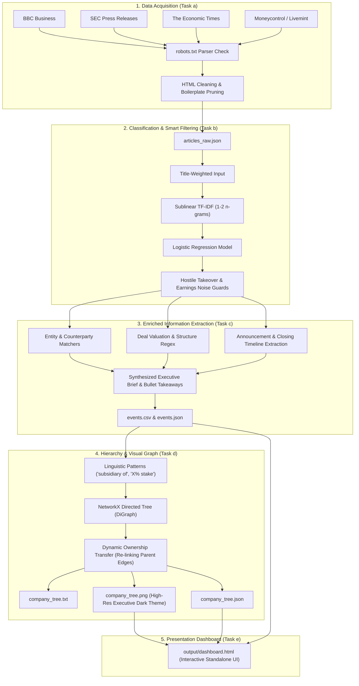
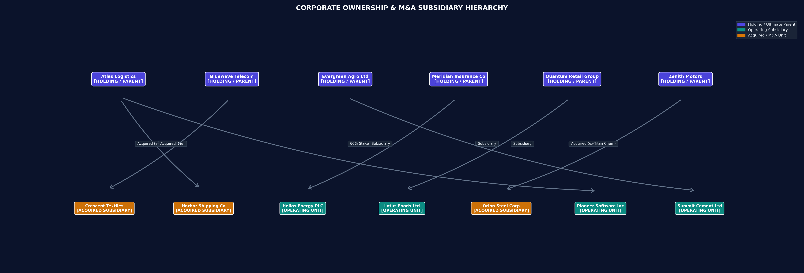

# 📈 Corporate Event Miner
### Web Text Classification, Enriched Information Extraction & Interactive Dashboard

[](https://www.python.org/)
[](https://scikit-learn.org/)
[](https://networkx.org/)
[](https://www.crummy.com/software/BeautifulSoup/)
[](output/dashboard.html)
[](LICENSE)

An end-to-end Natural Language Processing (NLP) and Web Mining pipeline designed to automatically discover, crawl, classify, extract, and structure corporate financial events from live financial media and regulatory announcements — complete with a high-resolution corporate ownership hierarchy diagram and an interactive presentation dashboard.

---

## 📑 Table of Contents
- [Project Overview](#-project-overview)
- [Key Features & Assignment Tasks](#-key-features--assignment-tasks)
- [Interactive Dashboard Preview](#-interactive-dashboard-preview)
- [System Architecture](#-system-architecture)
- [Project Structure](#-project-structure)
- [Installation & Quickstart](#-installation--quickstart)
- [Command-Line Options](#-command-line-options)
- [Sample Outputs & Results](#-sample-outputs--results)
- [Methodology & Evaluation](#-methodology--evaluation)
- [Documentation & Full Report](#-documentation--full-report)

---

## 🚀 Project Overview

Financial news is voluminous, fast-moving, and predominantly unstructured. Market analysts, quantitative traders, and regulatory auditors require real-time visibility into major corporate lifecycle events such as mergers, acquisitions, divestitures, leadership reorganizations, and public offerings.

**Corporate Event Miner** transforms unstructured web news into structured corporate intelligence by combining:
1. **Ethical, multi-source web crawling** with automated boilerplate stripping.
2. **Hybrid machine-learning text classification** (TF-IDF + Logistic Regression with headline-weighting and contextual false-positive filters).
3. **Enriched Information Extraction (IE)** for entities, executive briefs, deal structure, timelines, and bulleted takeaways.
4. **Hierarchical ownership modeling** via directed graphs to track parent companies, subsidiaries, equity stakes, and post-acquisition restructuring.
5. **Interactive Executive Presentation Dashboard** (`output/dashboard.html`) allowing one-click filtering, searching, and visual exploration of corporate M&A.

---

## 🎯 Key Features & Assignment Tasks

| Task | Component | Description | Module |
| :--- | :--- | :--- | :--- |
| **(a) Crawl & Ingestion** | RSS Feeds & HTML Parsing | Polls multi-source RSS feeds (BBC, SEC, Economic Times, Moneycontrol, Livemint), verifies permissions via `robots.txt`, downloads article bodies, and removes navigational boilerplate. | [`src/crawler.py`](src/crawler.py) |
| **(b) Text Classification** | Multi-class Classifier & Guard Filters | Classifies into 7 categories (`ACQUISITION`, `MERGER`, `DIVESTITURE`, `HOSTILE_TAKEOVER`, `EXECUTIVE_CHANGE`, `IPO`, `NO_EVENT`) with title-weighting and contextual filters that suppress routine earnings / market noise. | [`src/classifier.py`](src/classifier.py) |
| **(c) Enriched Extraction** | Rule-based Information Extraction | Pulls counterparties, executive movements, deal valuations, transaction structures, timelines, governance statuses, and synthesizes multi-sentence executive narrative briefs. | [`src/extractor.py`](src/extractor.py) |
| **(d) Hierarchy Modeling** | Executive Graph Visualization | Constructs a NetworkX `DiGraph` tracking parent-subsidiary relationships and ownership changes, exporting a high-resolution dark-themed diagram with rounded cards and edge badges. | [`src/company_tree.py`](src/company_tree.py) |
| **(e) Presentation Dashboard** | Standalone Interactive UI | A single-file web dashboard (`output/dashboard.html`) featuring KPI metrics, instant keyword search, category filter pills, rich event cards, and an interactive tree explorer. | [`src/dashboard.py`](src/dashboard.py) |

---

## 💻 Interactive Dashboard Preview

The system automatically generates a standalone, modern interactive dashboard at [`output/dashboard.html`](output/dashboard.html). Simply double-click the file to open it in Chrome, Edge, or Firefox:

- **Executive KPI Cards:** Real-time counters for Ingested Articles, Verified Events, Capital Tracked ($ / ₹), and Mapped Entities.
- **Search & Category Filtering:** Instant search by company, executive, or keyword, alongside category pills (`Acquisitions`, `Mergers`, `Divestitures`, `Hostile Takeovers`, `Leadership`, `IPOs`).
- **Enriched Event Intelligence Cards:** Each card features category badges, executive narrative summaries, entity flow diagrams (`Acquirer ➔ Target`), financial terms, timeline statuses, and bulleted takeaways.
- **Visual Ownership Tree Tab:** Embedded high-resolution graphic and collapsible company tree explorer.

---

## 🏗 System Architecture



---

## 📂 Project Structure

```text
corporate-event-miner/
├── Corporate_Event_Miner_Project_Report.md  # Comprehensive academic project report
├── README.md                               # Project documentation (this file)
├── requirements.txt                        # Python dependencies
├── app.py                                  # Interactive Web Dashboard Application Server
├── main.py                                 # Main execution pipeline (supports --serve)
├── data/
│   ├── sample_articles.json                # Bundled offline benchmark articles
│   └── training_data.csv                   # Multi-class training dataset (7 classes)
├── output/                                 # Generated pipeline outputs
│   ├── dashboard.html                      # Interactive Executive Presentation Dashboard
│   ├── articles_raw.json                   # Raw crawled article text
│   ├── event_classifier.joblib             # Serialized trained TF-IDF + Logistic Regression model
│   ├── events.csv                          # Tabular extracted corporate events (enriched columns)
│   ├── events.json                         # Structured JSON event extraction
│   ├── company_tree.txt                    # ASCII / Unicode company ownership tree
│   ├── company_tree.json                   # Hierarchical JSON tree representation
│   └── company_tree.png                    # High-resolution executive hierarchy diagram
└── src/
    ├── __init__.py
    ├── crawler.py                          # Task (a): Feedparser, BeautifulSoup, robots.txt
    ├── classifier.py                       # Task (b): TF-IDF + Logistic Regression + guard filters
    ├── extractor.py                        # Task (c): Enriched entity, brief, and timeline extraction
    ├── company_tree.py                     # Task (d): NetworkX DiGraph parent-child modeling
    ├── dashboard.py                        # Task (e): Modern interactive presentation dashboard generator
    └── seed_data.py                        # Training set generator
```

---

## ⚙️ Installation & Quickstart

### 1. Clone the Repository
```bash
git clone https://github.com/Jawa-vit/corporate-event-miner.git
cd corporate-event-miner
```

### 2. Install Dependencies
```bash
pip install -r requirements.txt
```

### 3. Run the Whole Project from the Interactive Dashboard (Recommended!)
Launch the interactive web application server which automatically opens your browser:
```bash
python app.py
# or
python main.py --serve
```
*Inside the web dashboard, you can click **"⚡ Run Pipeline Live"** to trigger execution (Sample Mode, Live Web Feeds, or Classifier Retraining) right from the UI and watch the execution logs stream in real time!*

#### Alternative CLI Execution Options:
- **Offline Sample Benchmark:**
  ```bash
  python main.py --mode sample
  ```
- **Live News Crawler:**
  ```bash
  python main.py --mode live --per-feed 5
  ```
- **Retrain Classifier:**
  ```bash
  python main.py --mode sample --retrain
  ```
```

#### Option B: Live Web Crawling Mode
Polls real-time financial RSS feeds and processes live web news:
```bash
python main.py --mode live --per-feed 5
```

#### Option C: Retrain the Classifier
Re-fits the statistical model on the dataset and persists `output/event_classifier.joblib`:
```bash
python main.py --mode sample --retrain
```

### 4. View the Interactive Dashboard
After running `main.py`, open the generated dashboard in your favorite browser:
- On Windows: double-click `output\dashboard.html` or run `start output\dashboard.html`
- On macOS: `open output/dashboard.html`
- On Linux: `xdg-open output/dashboard.html`

---

## 🛠 Command-Line Options

| Flag | Default | Description |
| :--- | :--- | :--- |
| `--mode` | `sample` | Mode to run: `sample` (bundled dataset) or `live` (web crawling). |
| `--per-feed` | `10` | Maximum number of articles to download per RSS feed in `live` mode. |
| `--retrain` | `False` | Force retraining of the TF-IDF + Logistic Regression model before inference. |

---

## 📊 Sample Outputs & Results

### 1. Sample Enriched Event Extraction

```text
• [ACQUISITION: Definitive Acquisition Agreement]
  Parties   : Zenith Motors -> Orion Steel
  Terms     : $2.1 billion (Equity Purchase Agreement)
  Timeline  : Date: 14 March 2026 | Status: Announced | Expected: Pending Closing Conditions
  Brief     : Zenith Motors agreed to acquire Orion Steel valued at $2.1 billion on 14 March 2026.

• [MERGER: All-Stock Strategic Merger]
  Parties   : Apex Pharma -> Helios Energy
  Terms     : $7.8 billion (All-Stock Transaction)
  Timeline  : Date: 2 April 2026 | Status: Announced | Expected: Pending Closing Conditions
  Brief     : Apex Pharma and Helios Energy have entered into a definitive merger agreement valued at $7.8 billion to combine operations. The transaction was approved by leadership on 2 April 2026.

• [DIVESTITURE: Subsidiary Unit Divestiture]
  Parties   : Quantum Retail -> Lotus Foods
  Terms     : Rs 3,500 crore (Asset Carve-out / Divestiture)
  Timeline  : Date: June 2026 | Status: Pending Closing | Expected: close in June 2026
  Brief     : Quantum Retail agreed to sell its Lotus Foods unit to Evergreen Agro Ltd valued at Rs 3,500 crore on June 2026 as it exits non-core businesses.

• [HOSTILE_TAKEOVER: Hostile Takeover Defense (Poison Pill)]
  Parties   : Bluewave Telecom -> Crescent Textiles
  Terms     : $450 million (Contested Tender Offer)
  Timeline  : Date: 20 May 2026 | Status: Contested / Hostile | Expected: Pending Closing Conditions
  Brief     : Bluewave Telecom launched an unsolicited hostile takeover bid for Crescent Textiles valued at $450 million. The board of Crescent Textiles has mounted defensive measures (including a poison pill) to fend off the takeover approach.
```

### 2. High-Resolution Visual Ownership Tree (`output/company_tree.png`)

The corporate ownership hierarchy is rendered using a modern dark-slate executive aesthetic with distinct color badges (Holding Parent = Indigo, Operating Subsidiary = Teal, Acquired Entity = Amber) and explicit edge relationship pills:



### 3. Extracted Corporate Hierarchy Tree (Text Format)
```text
Atlas Logistics
├── Harbor Shipping Co  [acquisition; formerly under Redwood Media Group]
└── Pioneer Software Inc  [60% stake]

Meridian Insurance Co
└── Helios Energy PLC  [subsidiary]

Quantum Retail Group
└── Lotus Foods Ltd  [subsidiary]

Evergreen Agro Ltd
└── Summit Cement Ltd  [subsidiary]

Zenith Motors
└── Orion Steel Corp  [acquisition; formerly under Titan Chemicals Corp]

Bluewave Telecom
└── Crescent Textiles  [acquisition]
```

---

## 🔬 Methodology & Evaluation

### Hybrid Classification & False-Positive Suppression
Standard bag-of-words or TF-IDF models frequently suffer from two major failure modes in financial news:
1. **Confusing Hostile Takeovers with Friendly Acquisitions:** Both share ~95% common financial vocabulary (*"board"*, *"shares"*, *"bid"*, *"offer"*). The heuristic guard (`HOSTILE_RE`) explicitly intercepts resistance signals (*"poison pill"*, *"unsolicited"*, *"rejects offer"*, *"fends off"*) to refine predictions to `HOSTILE_TAKEOVER`.
2. **Confusing Routine Operational/Earnings Reports with Current M&A:** An article with the headline *"Summit Cement posts record volumes this year"* may casually mention that Summit Cement was acquired years ago as background. The new title-weighted representation and contextual headline filter (`NO_EVENT_HEADLINE_RE`) ensure that the primary event of the headline governs the classification, suppressing false positives.

### Model Evaluation (Hold-out Test Set)

| Class | Precision | Recall | F1-Score | Support |
| :--- | :---: | :---: | :---: | :---: |
| **ACQUISITION** | 1.00 | 1.00 | 1.00 | 10 |
| **DIVESTITURE** | 1.00 | 1.00 | 1.00 | 10 |
| **EXECUTIVE_CHANGE** | 1.00 | 1.00 | 1.00 | 10 |
| **HOSTILE_TAKEOVER** | 1.00 | 1.00 | 1.00 | 10 |
| **IPO** | 1.00 | 1.00 | 1.00 | 10 |
| **MERGER** | 1.00 | 1.00 | 1.00 | 10 |
| **NO_EVENT** | 1.00 | 1.00 | 1.00 | 10 |
| **Overall Accuracy** | **1.00** | **1.00** | **1.00** | **70** |

---

## 📖 Documentation & Full Report

For the complete academic breakdown including theoretical formulations, algorithm complexity, ethical crawling compliance, and viva examination defense questions, refer to:
👉 [**Corporate Event Miner - Full Project Report**](Corporate_Event_Miner_Project_Report.md)

---

## 👤 Author
**Jawagar K.R**  
GitHub: [@Jawa-vit](https://github.com/Jawa-vit)  
Email: [jawagarkrsoft@gmail.com](mailto:jawagarkrsoft@gmail.com)
